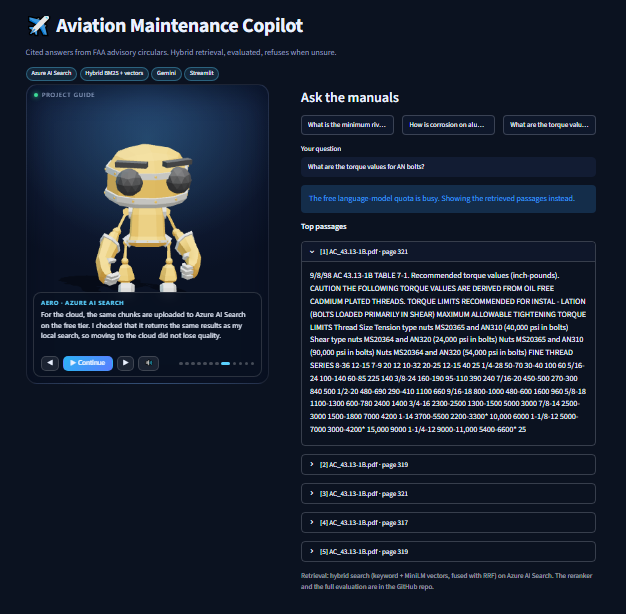
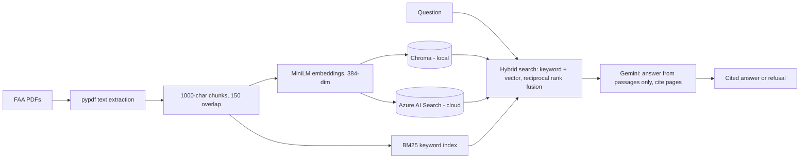

# Aviation Maintenance Copilot

Cited answers from FAA maintenance documents. Hybrid retrieval (keyword + vectors), evaluated on held-out questions, and it refuses to answer when the documents do not contain the answer.

**Live demo:** https://aviation-maintenance-copilot-pmruk7g8qvwvyaeh8enqwy.streamlit.app/ &nbsp;|&nbsp; **API docs:** https://copilot-api.calmsmoke-858062be.francecentral.azurecontainerapps.io/docs (the `/ask` endpoint needs an API key)



## The problem

A maintenance technician has thousands of pages of advisory circulars to search, and a wrong answer in this domain is expensive. This project answers a plain-English question with a short answer, the exact source page, and an honest refusal when the documents are silent.

Documents (5 public FAA PDFs): Advisory Circulars AC 43.13-1B and AC 43.13-2B, and three Airworthiness Directives for Cessna aircraft (2001-06-17, 2008-26-10, and 2008 Cessna 172/182 BRS), split into 2,536 overlapping chunks.

## How it works



- **Local pipeline** (`src/`): Chroma, BM25 and MiniLM, with an optional cross-encoder reranker. Used for development and evaluation.
- **Cloud API** (`api/`, `cloudsearch/`): FastAPI service in Docker on Azure Container Apps. It queries Azure AI Search for keyword and vector results and fuses them with the same reciprocal rank fusion recipe. The query embedding uses the same MiniLM model through ONNX (no PyTorch), and the vectors match the index (cosine 1.00000 on test sentences).
- **Demo page** (`app/`): Streamlit Community Cloud, with an interactive 3D guide (three.js) that explains the project.
- **Experimental agent** (`src/agent.py`): LangGraph plan, retrieve, grade, retry, answer, verify. See the results below. It is not the production path.

Safety behaviour: every answer cites numbered passages with their source page. If the passages do not contain the answer, the model must say so. A daily limit on model calls protects the free quota, and when the model is unavailable the API returns the retrieved passages instead of an error. Truncated model answers are never shown.

## Results

All numbers are produced by the scripts in this repo (`results/` holds the raw outputs). Question sets: 18 easy, 10 hard (paraphrased), and 10 held-out, plus 2 unanswerable questions in each of the hard and held-out sets. The held-out set was frozen before its first and only run. **Each set is small, so one question moves a rate by 5 to 10 points. Treat all numbers as indicative.**

### 1. Retrieval: does the right passage appear in the top results?

Hit@5 and Hit@10 are the number of questions where a correct passage is in the top 5 or top 10; MRR rewards ranking it higher. A passage counts as correct only if it contains the expected answer phrase (compared case-insensitively, ignoring spacing and dash types) and, where the question lists expected pages, comes from one of those pages of the expected document. "Local" runs on Chroma and BM25 on my machine, "Azure" runs on the deployed Azure AI Search index.

| Method | Easy (18) Hit@5 / @10 / MRR | Hard (10) Hit@5 / @10 / MRR | Held-out (10) Hit@5 / @10 / MRR |
|---|---|---|---|
| Local keyword (BM25) | 17 / 18 / 0.89 | 7 / 8 / 0.58 | 9 / 10 / 0.81 |
| Local vector (MiniLM) | 18 / 18 / 0.76 | 7 / 9 / 0.66 | 10 / 10 / 0.80 |
| Local hybrid (RRF) | 18 / 18 / 0.84 | 9 / 9 / 0.59 | 10 / 10 / 0.78 |
| Local hybrid + rerank | 18 / 18 / 0.94 | 10 / 10 / 0.90 | 9 / 10 / 0.86 |
| Azure keyword | 17 / 18 / 0.86 | 7 / 9 / 0.66 | 9 / 9 / 0.65 |
| Azure vector | 18 / 18 / 0.76 | 7 / 9 / 0.66 | 10 / 10 / 0.80 |
| Azure hybrid | 18 / 18 / 0.84 | 9 / 9 / 0.72 | 10 / 10 / 0.78 |

What it shows:
- **Hybrid never did worse than the best single method on Hit@5**, and on the hard set it found two more answers than either keyword or vector alone (9 vs 7). On the easy and held-out sets the sets are too easy to separate the methods on coverage.
- **Hybrid did not always rank better.** On the hard set local hybrid has a low MRR (0.59) despite high Hit@5, and on the held-out set keyword (0.81) ranks slightly better than hybrid (0.78). Hybrid is more reliable at finding the answer, not always at ranking it first.
- **Azure matches local** for hybrid and vector on Hit@5 in all three sets, so moving the index to the cloud lost no coverage. Azure MRR differs somewhat from local on keyword and hybrid (for example 0.65 vs 0.81 for keyword on held-out); I did not investigate why, but Azure uses its own keyword scoring rather than my BM25.
- **The reranker gives the best ranking** on easy and hard (MRR 0.94 and 0.90) but not on coverage: on the held-out set it lost one question at Hit@5 (9/10). It is slower, so it is optional and off by default.

### 2. Answers: baseline pipeline vs LangGraph agent

Model: `gemini-3.5-flash-lite`, run on 2026-10-29. "Correct citation" means the answer cites a passage from the expected page. "Key in passages" is the strict retrieval check.

| Set | System | Key in passages | Correct citation | False refusal | Correct refusal | LLM calls / question |
|---|---|---|---|---|---|---|
| Hard (dev) | Baseline | 0.9 | 0.9 | 0.1 | 1.0 | 1.0 |
| Hard (dev) | Agent | 0.9 | 0.9 | 0.1 | 1.0 | 3.5 |
| Held-out | Baseline | 1.0 | 1.0 | 0.0 | 1.0 | 1.0 |
| Held-out | Agent | 0.8 | 0.8 | 0.2 | 1.0 | 3.67 |

The baseline is the production pipeline. The agent matched it on the development set and lost on the held-out set at 3.5 to 3.7 times the model calls. Seconds per question are not reported as a comparison, because Gemini errors and retry waits distorted them.

**Why the agent lost:** its retry step replaced the first search results with the results of a rewritten query instead of keeping both. On the two held-out questions it refused, the answer phrase was in the baseline's passages but missing from the agent's final passages. The fix (merge old and new passages) is not applied, because the held-out set has already been used. It would need a fresh question set to test fairly.

### 3. Deployed service

- API answers in about 3 s end to end including the model call (two measurements on Azure Container Apps, hybrid retrieval).
- 63 automated tests run in CI on every push.
- Cost: €0 on free tiers (Azure AI Search free, Container Apps free grant with scale to zero, Streamlit Community Cloud, Gemini free tier).

## Mistakes found and fixed

- **Metric bug:** my citation check missed answers written as `[2, 4]`, which wrongly scored a correct agent answer as uncited. Fixed with a tolerant parser and a test.
- **Lenient metric:** the page-based hit rate counted two agent failures as hits. Adding the strict answer-phrase check exposed the real cause.
- **Truncated answers:** a model with hidden "thinking" used up the output limit and returned half a sentence. The API now disables that thinking on 2.5 models, raises the limit, and falls back to passages if an answer is cut off.
- **Name clash in deployment:** the app's helper package collided with the repo's own `src` package on Streamlit Cloud. Fixed by a separate `cloudsearch` package.

## Limitations

- Small evaluation sets over a small corpus of five documents (two advisory circulars and three Cessna directives). Results are indicative, not statistically conclusive.
- Answer-level quality was checked with page citations and the answer phrase, not with a large human-labelled set. [Add RAGAS scores here only if you run them.]
- The live demo uses Gemini's free tier. When the daily quota is used up, the three example questions show clearly labelled saved answers (generated earlier with the same pipeline), and any other question shows the retrieved passages without a written answer.
- No real user data and no measurement of time saved. This is a portfolio system, not a production deployment.
- The agent has a known retry flaw (see above).

## Run it yourself

```bash
python -m venv .venv && source .venv/bin/activate
pip install -r requirements.txt
# put the FAA PDFs in data/raw/, then:
python src/ingest.py                       # build the local index
PYTHONPATH=src python src/answer.py "What is the minimum rivet spacing?"   # needs GEMINI_API_KEY
pip install -r requirements-dev.txt && pytest -q
# evaluation
PYTHONPATH=src EVAL_FILE=data/eval/questions_hard.json python src/compare_retrievers.py
GEN_MODEL=gemini-3.5-flash-lite PYTHONPATH=src python src/compare_systems.py --file data/eval/questions_hard.json
# API
docker build -t copilot-api . && docker run --rm -p 8000:8000 -e AZURE_SEARCH_ENDPOINT -e AZURE_SEARCH_KEY -e GEMINI_API_KEY copilot-api
```

Environment variables: `AZURE_SEARCH_ENDPOINT`, `AZURE_SEARCH_KEY`, `GEMINI_API_KEY`, optional `API_KEY` (protects `/ask`), `GEN_MODEL`, `DAILY_LLM_LIMIT`.

## Repository layout

```
src/           local pipeline: ingest, retriever, rerank, answer, agent, evaluation
api/           FastAPI service
cloudsearch/   hybrid search against Azure AI Search (no PyTorch)
app/           Streamlit demo page and 3D guide
scripts/       one-off experiments and checks
tests/         63 tests (no keys, models or internet needed)
results/       raw evaluation outputs used in this README
data/eval/     question sets (easy, hard, held-out)
```

## Tools

Python, pypdf, sentence-transformers (MiniLM), fastembed/ONNX, ChromaDB, rank-bm25, Azure AI Search, Azure Container Apps, Azure Log Analytics, Gemini API, LangGraph, FastAPI, Docker, GitHub Actions, ghcr.io, pytest, Streamlit, three.js.

## Credits

3D guide model: "RobotExpressive" by Tomas Laulhe (CC0), from the three.js examples. three.js is MIT licensed. The FAA documents are U.S. government publications.
